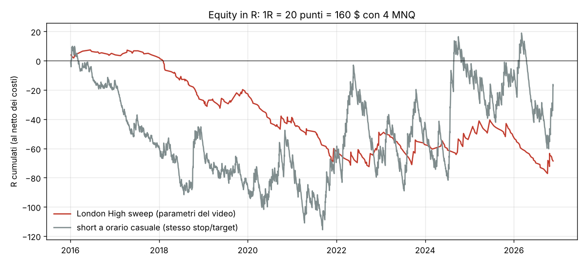

# Backtest: London High sweep (strategia del video)

Dati: Nasdaq-100 a 1 minuto (Dukascopy), 04/01/2016 → 20/11/2026, 2823 giorni di borsa.
Costi: 0,75 punti a trade. Se stop e target cadono nello stesso minuto si conta lo stop.

## 1. Parametri del video
Short con ordine limite 10 punti sopra il London High (02:00-05:00 NY), entrata tra 9:30 e 11:00 NY,
stop 20 punti, target 9R (180 punti), chiusura alle 15:55. Si salta il giorno se il London High
era già stato rotto prima delle 9:30.

| nome | trade | win_rate_% | target_% | R_medio | R_totale | profit_factor | max_drawdown_R | max_perdite_di_fila | punti_totali | trade_%_giorni | t_stat |
|---|---|---|---|---|---|---|---|---|---|---|---|
| sweep (video) | 351 | 17.7 | 4.6 | -0.195 | -68.6 | 0.77 | -84.6 | 33 | -1372.3 | 12.4 | -1.61 |
| short casuale | 2807 | 21.9 | 4.7 | -0.006 | -17.2 | 0.99 | -125.6 | 40 | -344.7 | 99.4 | -0.13 |
| sweep + conferma, 3R | 410 | 25.1 | 24.1 | -0.111 | -45.4 | 0.86 | -85.3 | 27 | -1432.0 | 14.5 | -1.31 |

### Anno per anno (parametri del video, 4 MNQ)
| anno | trade | win_rate_% | R_totale | dollari_4_MNQ |
|---|---|---|---|---|
| 2016 | 17 | 47.1 | 5.0 | 803.0 |
| 2017 | 14 | 42.9 | -2.0 | -324.0 |
| 2018 | 38 | 13.2 | -29.2 | -4670.0 |
| 2019 | 35 | 37.1 | 4.4 | 701.0 |
| 2020 | 40 | 12.5 | -17.0 | -2713.0 |
| 2021 | 39 | 10.3 | -22.3 | -3572.0 |
| 2022 | 41 | 17.1 | 10.0 | 1607.0 |
| 2023 | 29 | 10.3 | -6.3 | -1003.0 |
| 2024 | 26 | 19.2 | 3.4 | 546.0 |
| 2025 | 37 | 10.8 | 1.6 | 258.0 |
| 2026 | 35 | 5.7 | -16.3 | -2610.0 |

## 2. Le 10 varianti migliori negli anni < 2022, e come sono andate dopo
Se una variante è buona davvero, deve restare positiva anche negli anni che non ha "visto".

| modalita | lati | stop | offset | rr | trade_IS | R_medio_IS | t_stat_IS | trade_OOS | R_medio_OOS | t_stat_OOS |
|---|---|---|---|---|---|---|---|---|---|---|
| limite | long | 10.0 | 10.0 | 9 | 217 | 0.319 | 1.55 | 203 | -0.211 | -1.08 |
| limite | long | 20.0 | 25.0 | 9 | 126 | 0.297 | 1.24 | 173 | 0.038 | 0.17 |
| limite | long | 30.0 | 25.0 | 5 | 126 | 0.287 | 1.65 | 173 | 0.115 | 0.66 |
| limite | long | 20.0 | 25.0 | 5 | 126 | 0.183 | 0.98 | 173 | -0.068 | -0.41 |
| limite | long | 10.0 | 25.0 | 9 | 126 | 0.17 | 0.61 | 173 | -0.176 | -0.81 |
| limite | long | 30.0 | 25.0 | 9 | 126 | 0.17 | 1.0 | 173 | 0.124 | 0.61 |
| limite | long | 10.0 | 10.0 | 5 | 217 | 0.166 | 1.07 | 203 | -0.092 | -0.59 |
| limite | long | 30.0 | 25.0 | 2 | 126 | 0.158 | 1.34 | 173 | 0.017 | 0.15 |
| limite | long | 20.0 | 25.0 | 3 | 126 | 0.152 | 1.0 | 173 | -0.018 | -0.14 |
| limite | long | 30.0 | 25.0 | 3 | 126 | 0.148 | 1.07 | 173 | -0.068 | -0.53 |

Varianti testate: 190. Positive sia prima che dopo il 2022: 8. Con t-stat > 2 in entrambi i periodi: 0.

Tutte le varianti sono in `griglia_varianti.csv`, i singoli trade in `trade_parametri_video.csv`.
## 3. Conclusioni

- Il backtest **riproduce il trade del video** (22/10/2026): short alle 10:01, target 9R preso alle 10:26.
  Il massimo dopo l'entrata si è fermato a 2,5 punti dallo stop.
- Con le stesse regole, su quasi 11 anni: 351 trade, target preso nel 4,6% dei casi, **−69 R**
  (circa −11.000 $ con 4 MNQ), 33 perdite di fila, drawdown di 85 R. Nel 2026, l'anno del video:
  35 trade, 2 vincenti, −2.600 $.
- Entrare short sullo sweep del London High è andato peggio che entrare short a un orario casuale con
  lo stesso stop e target: lo sweep, da solo, non dà un vantaggio.
- Nessuna delle 190 varianti è significativa (t-stat > 2) sia prima sia dopo il 2022. Le 8 positive in
  entrambi i periodi sono quelle che ci si aspetta per puro caso su 190 tentativi.
- Limiti: dati del CFD sull'indice e non del future; nessun filtro discrezionale (bias del timeframe
  superiore, SMT con l'S&P, notizie), che il trader del video potrebbe usare.
